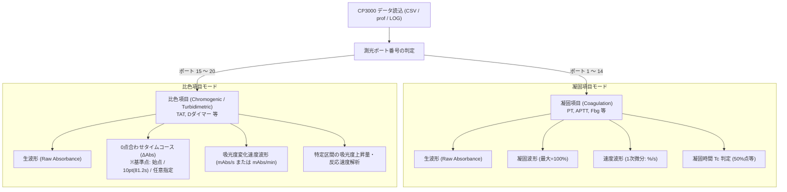

# CP3000 測定モード（凝固項目・比色項目）対応 実装計画書

## 1. 目的と概要 (Goal Description)

CP3000（CP3k）血液凝固分析装置には、大きく分けて **「凝固項目」** と **「比色項目」** の2種類の測定モードが存在します。
本アップデートでは、CSVの「測光ﾎﾟｰﾄ」番号からこれら2つの測定モードを自動分類し、それぞれの測定原理・分析目的に即した波形処理およびUI表示を提供できるように機能拡張を行います。



### 測定モードごとの特性と課題

| 項目 | ① 凝固項目 (Coagulation) | ② 比色項目 (Chromogenic / Latex) |
| :--- | :--- | :--- |
| **対象例** | PT, APTT, フィブリノーゲン 等 | TAT, Dダイマー, FDP, AT3 等 |
| **使用ポート** | **測光ﾎﾟｰﾄ 1 〜 14** | **測光ﾎﾟｰﾄ 15 〜 20** |
| **測定原理** | フィブリン析出に伴う透過光/散乱光の急激な変化 | 免疫比濁法（ラテックス凝集）や合成基質による吸光度・濁度変化 |
| **判定基準** | 凝固終了点（Te）を100%とした時の50%到達時刻（Tc：凝固時間 秒） | 特定区間における吸光度上昇量や反応速度 $y$ (mAbs/min) から濃度を算出 |
| **比較時の要件** | 0〜100% に正規化した波形・変曲点（速度ピーク）の比較 | **特定基準点（例: 10pt/81.2秒）をゼロ点（ベースライン）に揃えた**タイムコース比較および反応速度比較 |

---

## 2. ユーザー確認事項 (User Review Required)

> [!IMPORTANT]
> **設計判断および確認事項**
> 1. **比色項目の速度波形の主単位**:
>    - 凝固項目の速度波形は `%/s` ですが、比色項目の速度波形は吸光度変化速度となります。
>    - グラフの縦軸単位として、**`mAbs/s`**（秒あたりmAbs変化）または **`mAbs/min`**（分あたりmAbs変化、TATの処理値と同じ単位スケール：$1\,\text{mAbs/s} = 60\,\text{mAbs/min}$）のどちらを主表示にするかご希望をお伺いします。
>    - **提案（推奨）**: グラフ縦軸はCP3000の処理値に準拠した **`mAbs/min`**（または `mAbs/s` との切り替え）とし、ツールチップで両方の値を把握できるようにします。
>
> 2. **比色項目の0点合わせ基準点セレクターの仕様**:
>    - タイムコースをゼロ点合わせする基準として、以下の選択肢を用意する方針です：
>      - **「始点 (第1ポイント / 0.0s)」**
>      - **「TAT標準 (第10ポイント / 81.2s)」**（TAT等で一般的な反応開始基準点）
>      - **「任意ポイント指定」**（ドロップダウンまたはスライダーで、1〜Nポイント、または対応秒数を直接選択可能）
>    - このUI構成で問題ないかご確認いただけますと幸いです。
>
> 3. **凝固項目と比色項目が混在するバッチでの動作**:
>    - 一覧テーブルの上に **「測定モードフィルター」**（`[すべて, 凝固項目, 比色項目]`）を新設します。
>    - 重ね描き表示では、選択された項目群のモード（凝固 or 比色）に応じて、サイドバーの「波形の種類」や0点合わせUIが動的に切り替わる設計とします。

---

## 3. 実装計画と変更箇所 (Proposed Changes)

### 3.1 `cp3000/batch.py`：測定モードの自動分類とテーブル統合

#### 【変更内容】
- 測光ポート番号からモードを自動判定するヘルパー関数 `classify_measurement_mode(port_no)` を追加。
- `Batch.table` に `測定モード`（`"凝固項目"` / `"比色項目"` / `"その他"`）列を追加。
- CSVプロファイル（Section 2）および prof*.dat レコードの読み込み時に自動付与。

```python
# cp3000/batch.py に追加
MODE_COAGULATION = "凝固項目"
MODE_CHROMOGENIC = "比色項目"
MODE_UNKNOWN = "その他"

def classify_measurement_mode(port_no: Any) -> str:
    """測光ポート番号から測定モードを判定。
    1〜14: 凝固項目 (PT, APTTなど)
    15〜20: 比色項目 (TAT, Dダイマーなど)
    """
    try:
        p = int(port_no)
    except (ValueError, TypeError):
        return MODE_UNKNOWN
    if 1 <= p <= 14:
        return MODE_COAGULATION
    elif 15 <= p <= 20:
        return MODE_CHROMOGENIC
    return MODE_UNKNOWN
```

---

### 3.2 `cp3000/signal.py`：比色項目用シグナル処理（基準点補正・反応速度）

#### 【変更内容】
- 比色項目向けのタイムコース計算関数を追加：
  1. `align_baseline_at_point(arr2d, point_idx)`:
     指定されたポイントインデックス $idx$（または時刻 $t$）の値 $A(idx)$ を差し引き、$\Delta A = A - A(idx)$（指定点で0）を算出。
  2. `chromogenic_velocity_batch(arr2d, time_data, unit='min')`:
     生吸光度波形に対する一次微分 $dA/dt$ を算出（`mAbs/min` または `mAbs/s`）。
- `Derived` クラスに比色用の派生データ（`abs_slope` など）を格納可能にし、必要に応じてポイント指定の0点補正波形を動的生成。

```python
# cp3000/signal.py に追加
def align_chromogenic_baseline(
    arr2d: np.ndarray,
    point_index: int = 0,
) -> np.ndarray:
    """指定したポイント番号の吸光度を 0 にそろえるタイムコース差分波形 (ΔAbs) を計算。"""
    arr2d = np.asarray(arr2d, dtype=float)
    if arr2d.ndim == 1:
        arr2d = arr2d[None, :]
    out = arr2d.copy()
    if 0 <= point_index < arr2d.shape[1]:
        ref_vals = arr2d[:, point_index : point_index + 1]
        out = arr2d - ref_vals
    return out

def chromogenic_velocity_batch(
    time_data: np.ndarray,
    raw2d: np.ndarray,
    half: int = 2,
    as_per_minute: bool = True,
) -> np.ndarray:
    """比色項目の吸光度変化速度 (1次微分: mAbs/min または mAbs/s) を計算。"""
    # 既存の高精度 slope_batch を活用
    vel_per_sec = slope_batch(time_data, raw2d, half=half)
    if as_per_minute:
        return vel_per_sec * 60.0  # mAbs/min 換算
    return vel_per_sec
```

---

### 3.3 `cp3000/plots.py`：プロットパネルとラベル定義の拡張

#### 【変更内容】
- `WAVE_TYPES` に比色項目用の波形タイプを追加：
  - `"base_aligned"`: `("タイムコース(0点補正)", "吸光度変化 (ΔmAbs)")`
  - `"abs_slope"`: `("反応速度(1次微分)", "mAbs/min")`
- 比色タイムコース描画時、ユーザーが指定した基準点（$t_0, 0$）に視覚的マーカー（縦破線や基準点マーク）を表示可能にする。

```python
WAVE_TYPES: Dict[str, Tuple[str, str]] = {
    # 共通 / 凝固項目
    "raw": ("生波形", "吸光度(生値)"),
    "scaled": ("凝固波形(最大=100%)", "%"),
    "endpoint_scaled": ("凝固波形(終点=100%)", "%"),
    "slope": ("速度波形(1次微分)", "%/s"),
    "acceleration": ("加速度波形(2次微分)", "%/s²"),
    # 比色項目
    "base_aligned": ("タイムコース(0点補正)", "吸光度変化 (ΔmAbs)"),
    "abs_slope": ("反応速度(吸光度1次微分)", "mAbs/min"),
}
```

---

### 3.4 `app.py`：UIコントロール・動的切り替え・詳細タブの刷新

#### 【変更内容】
1. **サイドバー・表示設定**:
   - 選択中の波形群のモード判定（凝固中心か比色中心か）。
   - **凝固項目選択時**:
     - デフォルト波形: `["raw", "scaled", "slope"]`（生波形・最大100%凝固波形・1次微分速度波形）
     - Tc2位置マーク、凝固50%ラインの表示。
   - **比色項目選択時**:
     - デフォルト波形: `["raw", "base_aligned", "abs_slope"]`（生波形・0点補正タイムコース・反応速度波形）
     - **「0点合わせ基準ポイント」選択UI**:
       - プリセット: 「始点 (1pt / 0.0s)」「TAT標準 (10pt / 81.2s)」「カスタム選択」
       - カスタム選択時はスライダーまたはセレクトボックスでポイント番号・時刻を自在に指定可能。
       - 速度単位切り替え（`mAbs/min` / `mAbs/s`）。
2. **重ね描きタブ (tab_overlay)**:
   - フィルターに「測定モード（すべて / 凝固項目 / 比色項目）」を追加。
   - 一覧テーブルに「測定モード」列を表示。
   - CSVダウンロードで「タイムコース(0点補正)」「反応速度」のデータ出力に対応。
3. **1波形の詳細タブ (tab_detail)**:
   - **凝固項目の場合**: 従来の Tc1/Tc2/Te1/Te2 解析および 50% 凝固点マーカーを表示。
   - **比色項目の場合**:
     - 4分割パネル構成: 「生波形」「タイムコース(0点補正)」「反応速度(吸光度1次微分)」「反応区間拡大」
     - 計算値エリア:
       - 基準点時刻 $t_0$ と基準吸光度
       - TAT等の反応区間（例: 10pt〜20pt / 81.2s〜181.2s）での吸光度上昇量 $\Delta \text{Abs}$
       - 区間平均速度 $y$ (mAbs/min)
       - 装置測定値（CSVの処理値・濃度値）との対照

---

### 3.5 `tools/make_demo_batch.py`：比色項目（TAT等）を含むデモデータ生成

#### 【変更内容】
- 合成デモバッチに比色項目（例: TAT、測光ポート 15、項目番号 40）を追加。
- 反応初期ラグフェーズから濁度上昇フェーズ、プラトーに至るリアルな比色タイムコース曲線を生成。
- 開発時および配布パッケージでの動作確認・単体テストを自律完結。

---

### 3.6 `tests/test_viewer.py`：単体テストの拡充

#### 【テストケース】
- `test_measurement_mode_classification`: ポート1〜14が凝固項目、15〜20が比色項目に正しく分類されること。
- `test_chromogenic_baseline_alignment`: 指定ポイント（例: 10pt/81.2s）での吸光度が正確に 0 に補正されること。
- `test_chromogenic_velocity`: 吸光度1次微分の計算精度および単位変換（mAbs/s $\leftrightarrow$ mAbs/min）の検証。
- `test_full_batch_with_chromogenic_items`: 凝固・比色が混在するバッチの読み込みとテーブル統合の正常性検証。

---

## 4. 検証手順 (Verification Plan)

### 自動テスト (Automated Tests)
```powershell
# 単体テストの実行
.venv\Scripts\pytest tests/test_viewer.py -v

# 配布パッケージ結合テストの実行
.venv\Scripts\pytest tests/test_dist.py -v
```

### 手動確認 (Manual Verification)
1. **実CSVデータ (`demo_data/250326CSV_data.csv`) の読み込み**:
   - 全レコードが正しく「凝固項目」（ポート1〜14）と分類されること。
   - 生波形・最大100%凝固波形・1次微分速度波形がデフォルトで美麗に表示されること。
2. **合成デモバッチ（比色項目含む）の読み込み**:
   - 比色項目（TAT等、ポート15）が正しく「比色項目」と分類されること。
   - 0点合わせ基準点を「始点」から「10ポイント目 (81.2s)」に切り替えた際、グラフのタイムコース波形が 81.2s の位置でちょうど 0 に揃うこと。
   - 反応速度波形（mAbs/min）が正しく表示されること。
   - 詳細タブで比色項目特有の指標（基準点吸光度、区間上昇量、反応速度）が確認できること。
3. **CSVダウンロード機能**:
   - 比色項目の0点補正タイムコース波形および反応速度波形がCSVエクスポートできること。
