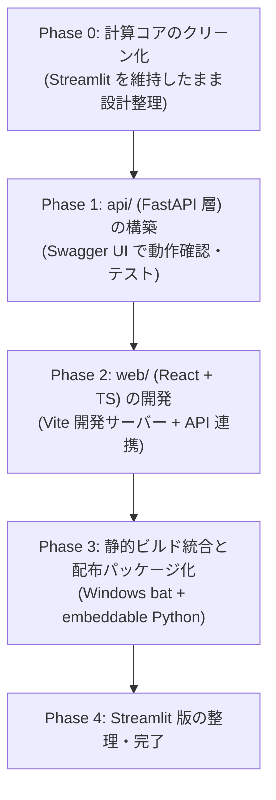

# CP3000 波形ビューワー 3層構成リファクタリング計画書
(React + FastAPI + 計算コア cp3000/)

## 1. Goal Description

### 背景と目的
現在の CP3000 波形ビューワーは、Python の **Streamlit** で UI・バックエンド・データ処理を一体化したモノリシックな構成となっています。
将来的に柔軟でリッチな UI/UX（自由なレイアウト、高速な波形インタラクション、より高度な操作性）を実現するため、以下の **3層アーキテクチャ** への移行を計画します：

```
┌────────────────────────────────────────────────────────┐
│  web/     React + TypeScript (UI層)                    │
│           自由な UI 設計、高レスポンスな波形操作       │
└───────────────────────────┬────────────────────────────┘
                            │ HTTP / REST API (JSON)
┌───────────────────────────▼────────────────────────────┐
│  api/     FastAPI (薄い API 層)                        │
│           ルーティング、リクエスト検証、キャッシュ     │
└───────────────────────────┬────────────────────────────┘
                            │ Python 内部呼び出し
┌───────────────────────────▼────────────────────────────┐
│  cp3000/  計算コア (ドメイン層・データ処理)            │
│           波形読込、突合、信号処理、Te/Tc 判定         │
└────────────────────────────────────────────────────────┘
```

本計画書は、**「現在のファイル群をどのように整理・リファクタリングし、安全かつ段階的に 3層構成へ移行するか」** のロードマップと設計仕様を定めたものです。

---

## 2. User Review Required

> [!IMPORTANT]
> **波形描画ライブラリの選定方針**
> 現行の Streamlit ではサーバー側で Python の `plotly.graph_objects` を使ってグラフを生成し、ブラウザに描画しています。
> React 移行後は、**「API からは純粋な波形データ配列（JSON）を返し、ブラウザ側で描画する」** のが推奨されます。
> - **候補 A: Plotly.js (`react-plotly.js`)**
>   - メリット: 現行の Plotly と見た目・インタラクション（ズーム、パン、ホバー、凡例トグル）が極めて近い。
>   - デメリット: バンドルサイズがやや大きい（1MB超）。
> - **候補 B: uPlot (`uplot-react`)**
>   - メリット: 科学計測・時系列データ描画に特化し、超軽量・超高速（数万点でも 60fps で滑らかにズーム・パン可能）。
>   - デメリット: ツールチップや凡例のデザインを自前で組む必要がある。
> - **候補 C: Chart.js / ECharts**
>   - メリット: 柔軟なカスタマイズ性。
>
> ※初期フェーズでは現行の操作感をそのまま再現できる **Plotly.js** を採用し、将来の大量波形同時レンダリングの最適化時に **uPlot** への差し替えを検討するアプローチを推奨します。

> [!NOTE]
> **オフライン配布パッケージ（Windows embeddable Python）の維持**
> 本プロジェクトの重要要件である「利用者が zip を展開して bat をダブルクリックするだけで動く（Python不要、ネット不要）」という仕組みは、**FastAPI が React のビルド済み静的ファイル（HTML/JS/CSS）を `StaticFiles` として配信する** ことで、完全に同一の形態（単一プロセス起動）で継続できます。

---

## 3. Open Questions

1. **フロントエンド開発環境について**:
   開発環境（あなたの PC）には Node.js (v18+ or v20+) および npm / pnpm がインストールされていますか？
   （※ビルド後の配布物は Python だけなので利用者は Node.js 不要ですが、開発者が React をビルドする際には Node.js が必要です）
2. **移行期間中の Streamlit 版の取り扱い**:
   React 版の完成まで、現行の `app.py`（Streamlit 版）をいつでも起動できる状態で併行維持する方針でよろしいでしょうか？（本計画では併行運用が可能な構成にしています）

---

## 4. Current Codebase Diagnosis (現状分析)

現在のコード資産を「計算コア」「UI/状態管理」「配布インフラ」に分類した評価です：

| ファイル | 現在の責務 | 3層構成における位置づけとリファクタリング方針 |
|---|---|---|
| `cp3000/prof.py` | `prof*.dat` のバイナリ読み込み (3600/6000点) | **【変更不要】** 完全な純粋ドメインコード。`cp3000/` 内にそのまま維持。 |
| `cp3000/log.py` | `LOG*.dat` の解析 (依頼情報、サンプリング) | **【変更不要】** 完全な純粋ドメインコード。`cp3000/` 内にそのまま維持。 |
| `cp3000/signal.py` | 移動平均、累積、速度、加速度、Te/Tc、アライメント | **【変更不要】** 完全な純粋ドメインコード。NumPy/Pandas のみで動作。そのまま維持。 |
| `cp3000/batch.py` | バッチ探索・CSV読込・突合・`Batch` クラス | **【ほぼそのまま】** ドメインサービスクラスとして `cp3000/` に維持。FastAPI から呼び出す。 |
| `cp3000/plots.py` | Plotly Figure 生成 (`overlay_figure`, `detail_figure`) | **【役割の整理】** 現行は Streamlit 向け。React 化によりブラウザ側描画へ移行するため、コアからは切り離し、移行期間中の互換レイヤーとして扱う。 |
| `app.py` | 設定、キャッシュ、フィルタ、状態、画面描画 (585行) | **【分解】**<br>・設定/ファイル/バッチ状態/計算要求 ➔ `api/` (FastAPI)<br>・UI/テーブル選択/フィルタ/描画 ➔ `web/` (React) |
| `dist_files/` | `start_viewer.bat`, `viewer_ctl.py` | **【起動先を FastAPI へ変更】** `streamlit run app.py` から `uvicorn api.main:app` へ切り替え。 |
| `tools/build_dist.py` | 配布パッケージ zip の作成 | **【更新】** React の静的ビルド成果物を含め、依存ライブラリを FastAPI + Uvicorn に更新。 |

---

## 5. Proposed Architecture & Directory Structure

リファクタリング後の理想的なディレクトリ構成案です：

```
cp3000-waveform-viewer/
├── cp3000/                    # 【計算コア】波形計算・ファイル読込（今のコードをそのまま維持）
│   ├── __init__.py
│   ├── prof.py                # prof*.dat 読込
│   ├── log.py                 # LOG*.dat 解析
│   ├── signal.py              # 波形計算 (移動平均, 累積, 速度, 加速度, Te/Tc)
│   ├── batch.py               # バッチ探索, 突合, Batchクラス
│   └── (plots.py)             # ※当面維持（Streamlit併行用 / 後述）
│
├── api/                       # 【FastAPI 層】画面と計算をつなぐ薄い API
│   ├── __init__.py
│   ├── main.py                # FastAPI アプリ初期化, CORS, 静的ファイル配信 (web/dist)
│   ├── routes/                # 機能別ルーター
│   │   ├── __init__.py
│   │   ├── system.py          # /api/health, /api/settings
│   │   ├── batches.py         # /api/batches (探索, ロード, 一覧, サマリ)
│   │   ├── waveforms.py       # /api/waveforms/derive (派生波形計算データ取得)
│   │   └── export.py          # /api/export/csv (CSV ダウンロード)
│   ├── schemas/               # リクエスト / レスポンスの Pydantic モデル
│   │   ├── batch.py           # BatchSummary, RecordItem, BatchLoadRequest
│   │   ├── waveform.py        # DeriveRequest, WaveformSeriesResponse
│   │   └── settings.py        # SettingsSchema
│   └── services/              # セッション・インメモリキャッシュ管理
│       └── session_store.py   # 読み込み済み Batch インスタンスのキャッシュ管理
│
├── web/                       # 【React + TypeScript】自由な UI 設計
│   ├── package.json
│   ├── vite.config.ts         # 開発時は FastAPI(8000) へのプロキシを設定
│   ├── tsconfig.json
│   ├── src/
│   │   ├── main.tsx
│   │   ├── App.tsx            # メインレイアウト（サイドバー + タブ構成）
│   │   ├── api/               # API クライアント (fetch / axios / TanStack Query)
│   │   │   └── client.ts
│   │   ├── components/        # 再利用可能な UI 部品
│   │   │   ├── Sidebar/       # データ選択・表示オプション・計算設定
│   │   │   ├── WaveformChart/ # 重ね描きチャート (Plotly.js 等)
│   │   │   ├── DetailChart/   # 1波形詳細チャート
│   │   │   ├── RecordTable/   # 波形一覧テーブル (TanStack Table 等)
│   │   │   └── SummaryChips/  # ヘッダー情報バッジ
│   │   ├── hooks/             # カスタムフック (データ取得, 波形アライメント状態)
│   │   └── types/             # TypeScript 型定義 (API スキーマと同期)
│   └── dist/                  # ビルド成果物 (FastAPI が配布時に配信)
│
├── dist_files/                # 配布パッケージ用ファイル
│   ├── start_viewer.bat       # Uvicorn 起動に変更
│   ├── update_viewer.bat      # 共有フォルダ更新
│   └── viewer_ctl.py          # ヘルスチェック・ブラウザ起動
│
├── tools/                     # ビルド・ユーティリティ
│   ├── build_dist.py          # React ビルド + Python 配布 zip 化
│   ├── make_demo_batch.py     # 合成バッチ作成 (そのまま)
│   └── check_against_cwa.py   # 元コード一致確認 (そのまま)
│
├── tests/                     # 自動テスト
│   ├── test_viewer.py         # 計算コアのテスト (そのまま維持)
│   ├── test_api.py            # 【NEW】FastAPI エンドポイントのテスト
│   └── test_dist.py           # 配布パッケージのテスト
│
├── app.py                     # 【既存】Streamlit アプリ（移行完了まで併行維持）
├── requirements.txt           # fastapi, uvicorn などを追加
└── run_viewer.bat             # 開発用起動 bat
```

---

## 6. Detailed Implementation & Refactoring Phases

移行は以下の **4 つのフェーズ** で安全に進めます。



### Phase 0: 計算コア `cp3000/` のクリーン化と準備
- **目的**: 既存の Streamlit アプリを一切壊さずに、API から呼び出しやすいように境界を整える。
- **作業内容**:
  1. `cp3000/batch.py` の `Batch` クラスに、JSON シリアライズしやすい辞書出力メソッド（`to_summary_dict()`, `get_records_dataframe()` 等）を用意。
  2. `app.py` 内に直書きされている「インメモリキャッシュの仕組み」を、Streamlit 以外の環境（FastAPI）でも使える汎用クラス `BatchSessionStore` として抽出する準備。
  3. `requirements.txt` に `fastapi`, `uvicorn[standard]` を追加。

### Phase 1: `api/` (FastAPI 層) の構築
- **目的**: `app.py` にあるデータ取得・計算指示ロジックを FastAPI エンドポイントとして独立させる。
- **設計するエンドポイント**:

| メソッド | パス | 役割 | 呼出先コア |
|---|---|---|---|
| `GET` | `/api/health` | 起動確認・ヘルスチェック | なし |
| `GET` | `/api/settings` | 設定取得 (`settings.json`) | `load_settings()` |
| `POST` | `/api/settings` | 設定保存 | `save_settings()` |
| `GET` | `/api/folders` | 親フォルダ下のバッチフォルダ一覧探索 | `find_batch_folders()` |
| `POST` | `/api/batches/load` | 指定フォルダ or アップロードからバッチ読込 | `load_batch()` |
| `GET` | `/api/batches/current` | 現在ロード中のバッチ概要（検体数、警告など） | `Batch` インスタンス |
| `GET` | `/api/batches/records` | 波形一覧テーブル用データ（絞り込み・ソート対応） | `batch.table` |
| `POST` | `/api/waveforms/derive` | 選択された複数波形の派生データ（生、0-100%、速度、加速度、アライメント）を一括計算して返却 | `batch.derive()` |
| `POST` | `/api/export/csv` | 表示中波形または一覧の CSV エクスポート | `pd.DataFrame.to_csv()` |

- **検証**:
  FastAPI 標準の Swagger UI (`http://localhost:8000/docs`) および `pytest tests/test_api.py`（FastAPI の `TestClient`）で、Web 画面を作らずとも全 API の動作と計算結果の整合性を検証。

### Phase 2: `web/` (React + TypeScript) フロントエンドの構築
- **目的**: React + TypeScript + Vite による最新のフロントエンド環境を構築し、現行 Streamlit の 3 つの画面（重ね描き、詳細、一覧）を再現・強化する。
- **技術スタック**:
  - **ビルドツール**: Vite (高速 HMR、簡単な静的ビルド)
  - **言語**: TypeScript (型安全な波形データハンドリング)
  - **UI / スタイル**: Tailwind CSS + アイコン (Lucide React)
  - **チャート描画**: Plotly.js (`react-plotly.js`) または uPlot
  - **状態管理**: Zustand（UIの選択状態や表示設定）+ TanStack Query（APIキャッシュ）
- **画面構成**:
  - `Header`: バッチ名、ファイル情報チップ（prof, CSV, LOG, 点数）、サマリ指標カード
  - `Sidebar`: データソース選択（フォルダ/アップロード）、波形種別（raw, scaled, slope, acceleration）、時間軸そろえ（off, tc2, peak, rise）、計算設定（解析窓、Tc割合）
  - `Tab 1: 重ね描き`: 左側に一覧テーブル、右側に複数パネルの連動チャート
  - `Tab 2: 1波形の詳細`: 1波形の全点表示、Te/Tc・測定値の縦線マーカー、詳細値テーブル
  - `Tab 3: 一覧・読込情報`: 全波形テーブル、CSVダウンロード、読込ファイル詳細

### Phase 3: 静的ビルド統合と配布パッケージ化
- **目的**: 配布 zip で React + FastAPI が単一プロセスで起動するように統合する。
- **統合手順**:
  1. `web/` で `npm run build` を実行すると `web/dist/` に静的成果物が出力される。
  2. `api/main.py` で FastAPI の `StaticFiles` を使い、ルートパス `/` で `web/dist` をマウント：
     ```python
     from fastapi.staticfiles import StaticFiles
     # API ルートの登録後...
     app.mount("/", StaticFiles(directory="web/dist", html=True), name="static")
     ```
  3. `dist_files/start_viewer.bat` の起動コマンドを更新：
     ```bat
     "%~dp0runtime\python.exe" -m uvicorn api.main:app --host 127.0.0.1 --port %CP3000_PORT%
     ```
  4. `dist_files/viewer_ctl.py` のヘルスチェック先を `/_stcore/health` から `/api/health` に変更。
  5. `tools/build_dist.py` に「React ビルド成果物を配布 zip に含める」処理を追加。

### Phase 4: Streamlit 版の整理
- React 版が完全に機能し、ユーザーテストで問題がないことを確認した後、`app.py` をアーカイブまたは削除。
- `requirements.txt` から `streamlit` を削除し、配布パッケージの軽量化を達成。

---

## 7. Verification Plan (検証計画)

### 7.1 自動テスト (Automated Tests)
1. **計算コアの回帰テスト**:
   ```bat
   .venv\Scripts\python -m pytest tests/test_viewer.py -v
   ```
   - 既存の合成データを用いた計算テスト・突合テストが 100% 通過することを維持。
2. **API エンドポイントテスト (新規追加)**:
   ```bat
   .venv\Scripts\python -m pytest tests/test_api.py -v
   ```
   - `TestClient` を用い、フォルダ探索、バッチ読込、波形派生計算、CSV出力の各レスポンスとステータスコードを検証。
3. **配布パッケージ・起動テスト**:
   ```bat
   .venv\Scripts\python -m pytest tests/test_dist.py -v
   ```
   - FastAPI 化された配布 zip のビルド、bat 起動、ヘルスチェック、ブラウザ起動が正しく動くか検証。

### 7.2 手動検証 (Manual Verification)
1. **API レベルの検証 (Phase 1 完了時)**:
   - ブラウザで `http://127.0.0.1:8000/docs`（Swagger UI）を開き、`demo_data` の読み込みと派生波形計算リクエストを送信してレスポンス値（Tc2, Te2, 波形配列）を確認。
2. **Web 画面の検証 (Phase 2 完了時)**:
   - `npm run dev` で起動した画面で、Streamlit 版と全く同じ操作（フォルダ選択、波形複数選択、時間軸アライメント、詳細タブの前後移動、CSV保存）が動作することを目視確認。
3. **配布パッケージの検証 (Phase 3 完了時)**:
   - `python tools/build_dist.py` で作成した zip を別フォルダに展開し、`start_viewer.bat` をダブルクリックしてブラウザが自動で開き、画面が表示されることを確認。
